# 🦉 Autonomous Wildlife Camera — Noctua

An experimental, autonomous wildlife observation station built to support long-term, low-disturbance field monitoring.

**Project status (October 2026):** Raspberry Pi preparation completed; Umbra camera accessible over the local network; RTSP video reception and initial performance measurements validated. **The station is not yet autonomous or field-deployed.**

> **Observe → Test → Measure → Document → Improve**

## Project goals

- Continuous wildlife observation, including day and night
- A live video feed accessible remotely
- Long unattended operation, ultimately measured in months
- Local recording, monitoring and fault recovery
- Cellular connectivity and off-grid power
- Reproducible tests and documentation without exposing sensitive wildlife locations

## Components and status

| Component | Status | Notes |
| --- | --- | --- |
| Raspberry Pi 5 (Noctua) | **Installed and tested** | Linux, SSH, Git access, Python virtual environment and basic health checks |
| Reolink RLC-811A (Umbra) | **Received and tested** | RTSP secondary H.264 and main 4K H.265 streams accessed |
| PLANET IPOE-162 PoE injector | **Received; operating setup used for camera tests** | Exact wiring, labeling and electrical compatibility still require a documented inspection |
| LEICKE NT03242, 24 V / 2 A | **Measured** | 24.46 V DC at the supply output; not a measurement of PoE output or station power consumption |
| Kali Linux + VS Code + GitHub | **In use** | Development, remote administration and documentation |
| USB 3 SSD | **Planned; integration not validated** | Local video and log storage |
| Teltonika RUT241 | **Planned; not validated** | Cellular networking and remote access |
| Battery, solar panel and charge controller | **Not finalized** | Design depends on measured energy requirements |

The architecture and selected parts may change after tests. A selected component is not necessarily purchased, installed or validated.

## Completed tests

- Raspberry Pi startup, system update and SSH access
- Raspberry Pi GitHub SSH access and Python virtual environment
- Local RTSP service available on TCP port 554
- Secondary camera stream identified as **H.264, 640 × 360**, nominal metadata **25 fps**
- Main camera stream identified as **H.265/HEVC, 3840 × 2160**, nominal metadata **25.5 fps**
- Short video processing tests on the Raspberry Pi 5
- Initial CPU and memory comparison for 4K video processing

### Initial 4K results (30-second tests)

| Measurement | Full video decode | Compressed stream copy |
| --- | ---: | ---: |
| Average FFmpeg CPU | 163% | 1% |
| Peak resident memory | 372,368 KB (~364 MiB) | 60,144 KB (~59 MiB) |
| Wall-clock time | 30.66 s | 31.60 s |
| Exit status | 0 | 0 |

**Interpretation:** handling the compressed 4K stream without decoding is far less CPU-intensive than decoding every frame. These are short tests, **not proof of long-term stability**. The stream-copy test emitted non-monotonic DTS warnings, which must be investigated before relying on recordings.

The preliminary design direction is to use the lower-resolution H.264 stream for analysis and reserve the 4K H.265 stream for high-quality recording or selected captures. This architecture remains to be implemented and validated.

## Documentation

- **[Umbra: beginner-friendly setup, RTSP and Raspberry Pi performance tests](docs/umbra-installation-rtsp-performance.md)** — observed commands, expected outputs, troubleshooting, measurements and safety notes
- **[Project map (Markmap source)](project-map.md)** — architecture, validation stages and open questions
- **[Raspberry Pi setup](docs/raspberry-pi-setup.md)** — initial configuration and observed system checks
- **[V1 test-bench plan](docs/test-bench-v1.md)** — electrical design caveats, measurement points and endurance-test plan
- **[Technical decision log](docs/decision-log.md)** — dated choices, evidence and open decisions

**Note:** The SVG is a simplified visual overview; the Markdown project map contains the more detailed plan.

## Next validation stages

- [ ] Inspect and document the precise PoE connections, supply specifications and wiring
- [ ] Verify camera firmware and software versions and document Reolink settings
- [ ] Rotate any camera credentials exposed in earlier test screenshots
- [ ] Validate real recording files, timestamps and disk usage
- [ ] Test stream stability, temperatures and reconnection over longer periods
- [ ] Measure complete-system power consumption, including night/IR operation
- [ ] Implement secure remote live viewing and verify recovery after outages
- [ ] Integrate storage and cellular networking
- [ ] Run a **72-hour test bench** before sizing off-grid power
- [ ] Select the installation site without publishing sensitive coordinates

## Reproducibility and security

Each test should record its purpose, prerequisites, exact commands, observations, limitations and next steps. Do not commit credentials, expanded RTSP URLs containing passwords, private keys, site coordinates or sensitive wildlife observations.

The goal is a reliable and understandable station, not just a demonstration that video can be displayed.
