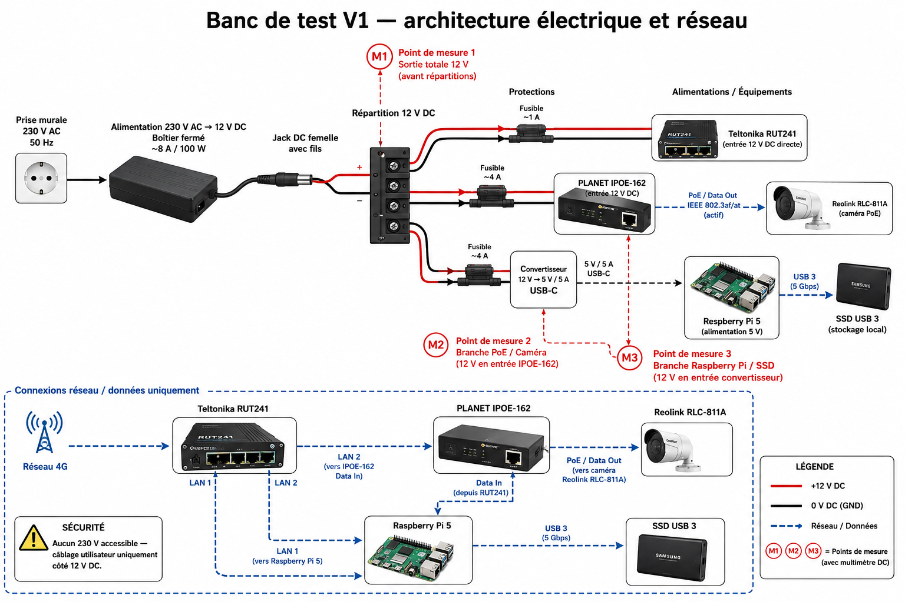

# V1 Test Bench — Design and Validation Plan

**Last reviewed:** 2026-10-19  
**Status:** Conceptual design under revision. **Not a validated wiring diagram.**

## Purpose

The test bench will validate a single-camera Noctua station before field deployment, including video reception, power consumption, recording, connectivity and fault recovery.

### What has already been demonstrated

- Raspberry Pi 5 boots and is accessible over SSH.
- Umbra (Reolink RLC-811A) delivers RTSP video to the local network.
- Secondary H.264 and main 4K H.265 streams were identified.
- Short FFmpeg CPU and memory tests were completed.
- The LEICKE NT03242 supply output was measured at **24.46 V DC** (nominal 24 V / 2 A).

These are **not** full-system energy or long-duration reliability tests.

## Historical architecture diagram

**Warning:** The image above is an **early conceptual diagram**. It may show a common 12 V distribution bus and connections that have not been electrically validated. **Do not use it as a build or wiring instruction.**

The original proposal included:
- A 12 V DC distribution bus
- A Teltonika RUT241 router
- A PLANET IPOE-162 PoE injector and Reolink RLC-811A camera
- A 12 V-to-5 V converter for the Raspberry Pi 5
- A USB 3 SSD

**Design discrepancy to resolve:** the earlier diagram depicts a 12 V branch to the PoE injector, whereas the equipment used in recent camera tests includes a **24 V** LEICKE supply. The injector's exact permitted input range, wiring, polarity, output mode and camera compatibility must be checked against the actual hardware documentation before specifying a final power architecture. A measured supply voltage does not prove PoE compatibility.

The final 12 V, 24 V or mixed-voltage topology **has not yet been selected or validated**.

## Planned electrical measurements

| Point | Location | Intended measurement |
| --- | --- | --- |
| M1 | Complete power system, once designed | Total voltage, current, average and peak power |
| M2 | Camera and PoE injector supply branch | Day/night and IR-related consumption |
| M3 | Raspberry Pi and storage supply branch | Idle/load power and storage impact |
| M4 | Cellular router supply branch, once integrated | Network and reconnection consumption |

Measurement points are provisional until the circuit and instruments are verified. Never connect a multimeter in current mode directly across a voltage source.

## Planned 72-hour test

1. Confirm exact hardware specifications, cable connections, protective devices and safe measurement procedures.
2. Record software and firmware versions.
3. Validate actual saved video files, timestamps and playback.
4. Record baseline power consumption and night/IR behavior.
5. Test continuous operation, temperatures, network stability and storage growth.
6. Simulate and document safe restart and recovery scenarios.
7. Summarize failures, missing data, energy consumption and storage requirements.

### Pass/fail criteria — to define before the test

- Recording availability and file integrity
- Acceptable thermal and power behavior
- Recoverability after interruptions
- Storage capacity and retention requirements
- Sufficient evidence for battery and solar sizing

Do not declare the test successful without dated logs and measurements.

## Safety and outstanding decisions

- [ ] Verify IPOE-162 electrical specifications and photograph exact connections
- [ ] Confirm the final distribution voltage(s) and suitable converters
- [ ] Select and validate fuses, wire gauges and connectors
- [ ] Confirm safe power delivery for the Raspberry Pi 5
- [ ] Select power measurement instruments and procedures
- [ ] Produce a new, verified electrical schematic
- [ ] Integrate SSD and cellular router
- [ ] Finalize the 72-hour test protocol
- [ ] Run the test and publish its measured results

All mains wiring must remain enclosed in suitable commercial equipment. Experimental work is restricted to safely designed low-voltage circuits.

**Related:** [Umbra RTSP and performance guide](umbra-installation-rtsp-performance.md) · [Decision log](decision-log.md).
